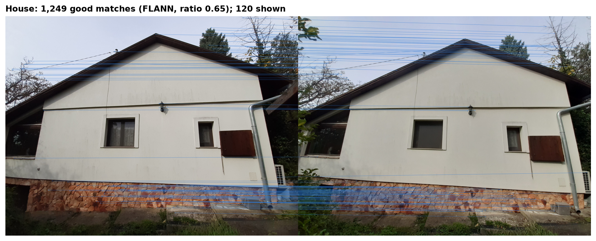
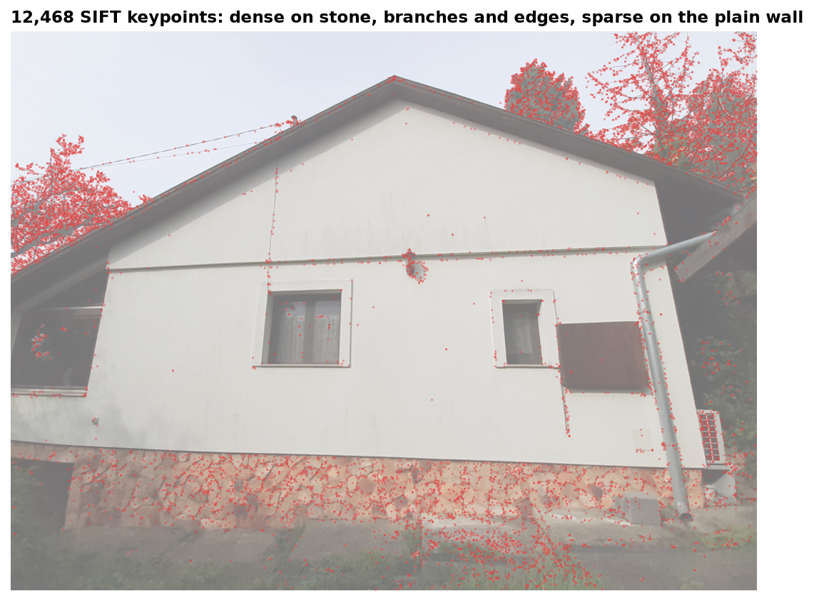
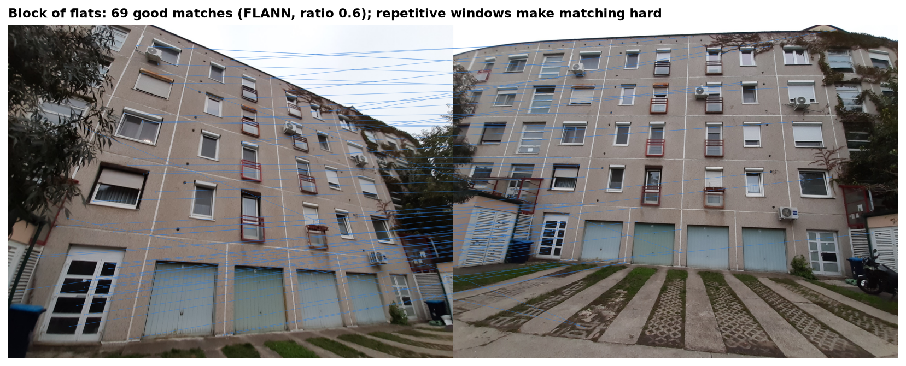

# Finding Matching Points Between Photos with SIFT

  

**Case study:** [rolandkeszi.github.io/projects/sift.html](https://rolandkeszi.github.io/projects/sift.html)

I photographed two buildings, the side wall of a house and the facade of a block of flats, from different angles and distances with two different cameras. I then used the **SIFT** algorithm to find and match the same points across the photos.

<p align="center"></p>

## Method

1. **Detection:** `cv.SIFT_create()` finds keypoints and computes a 128-dimensional descriptor for each one, on both images.
2. **Matching:** for every descriptor in the first image, the two nearest descriptors in the second image are found (k = 2). This uses either brute-force matching (`BFMatcher`) or **FLANN** (Fast Library for Approximate Nearest Neighbors), which searches KD-trees and is much faster on large descriptor sets.
3. **Ratio test (Lowe):** a match is kept only if the nearest neighbour is clearly closer than the second nearest, for example below 68% of its distance. The lower the ratio, the stricter the filter.

<p align="center"></p>

Keypoints concentrate on texture: the stone base, the tree branches and the edges. The plain wall gives very few.

## Results

| Image pair | Keypoints | FLANN, ratio 0.60 | FLANN, ratio 0.65 | FLANN, ratio 0.70 | Brute force, ratio 0.68 |
|---|---|---:|---:|---:|---:|
| House 1 – 2 | 12,468 / 14,736 | 1,084 | **1,249** | 1,452 | 1,328 |
| Flats 1 – 2 | 8,409 / 12,617 | **69** | 107 | 167 | 122 |
| Flats 1 – 3 | 8,409 / 7,012 | **26** | 48 | 106 | 62 |
| Flats 1 – 4 | 8,409 / 9,771 | 431 | 536 | 674 | 592 |

The original analysis reported 1,256, 67 and 30 good matches for the first three pairs. The re-run gives 1,249, 69 and 26 (bold in the table). The small differences come from FLANN's approximate search and the OpenCV version.

<p align="center"></p>

## Conclusions

- **Texture-rich scenes match well.** The house pair gives more than a thousand reliable matches. SIFT also matches the surrounding objects, such as the tree branches, not only the building.
- **Repetitive structures are hard.** Identical windows on a block of flats leave far fewer distinctive matches, and some are visibly false, for example between the wall and the concrete strip in front of the garages.
- **The ratio threshold trades quantity for reliability**, and FLANN gives practically the same result as brute-force matching at a fraction of the cost.

## Run it

```bash
pip install -r requirements.txt
jupyter notebook notebooks/sift_matching.ipynb
```

The `images/` folder contains my own photos with all metadata removed.

## Reference

Lowe, D. G. (2004). Distinctive image features from scale-invariant keypoints. *International Journal of Computer Vision*, 60(2), 91–110.

## License

© 2026 Roland Keszi. This work is licensed under [CC BY-NC 4.0](https://creativecommons.org/licenses/by-nc/4.0/): you may share and adapt it for non-commercial purposes, provided you credit the author (Roland Keszi) and link to this repository. Third-party datasets keep their own licenses. See [`LICENSE`](LICENSE).
